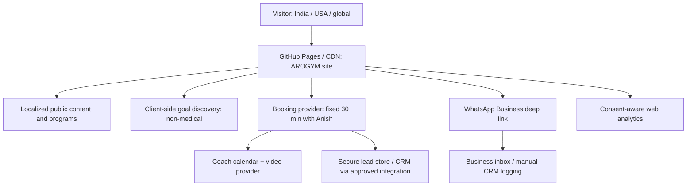
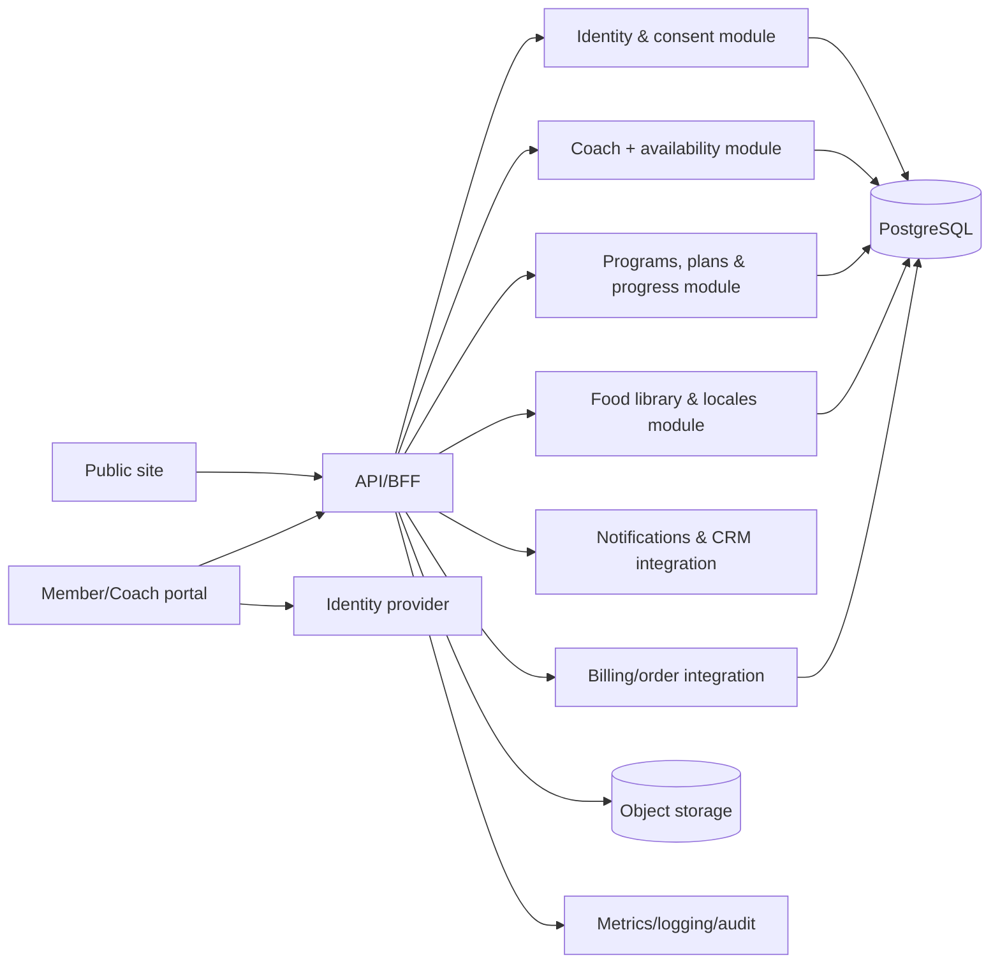
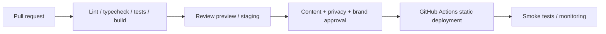

# Architecture & scalability model

## Architecture decision
**Start with a static public website + managed integrations; evolve to a modular backend.** Avoid premature microservices. GitHub Pages is appropriate for public static pages but **not** private assessments, booking state, CRM databases, authentication or payment processing.

## Phase 1 — marketing and bookings

### Separation of concerns
- Public static site **never stores** private intake data.
- Booking provider manages availability, timezones, confirmations and reschedules.
- WhatsApp handles customer-initiated enquiries, not sensitive medical-record storage.
- CRM tracks consent, source, status and follow-up with appropriate access.
- The coach's private calendar details are not published as data.

## Phase 2 — modular coaching platform

### Recommended technology (to evaluate at implementation)
- Frontend: Next.js + TypeScript; static export only for public GitHub Pages deployment. Do not rely on server actions/API routes there.
- Design: Tailwind or CSS tokens + accessible component library.
- CMS: content files initially; headless CMS later if editing workflow justifies it.
- Backend later: TypeScript modular monolith / API and PostgreSQL on managed infrastructure.
- Auth later: managed OIDC and role/tenant-aware authorization.
- Integrations: dedicated adapters for scheduler, messaging, CRM, payment processors and video provider.
- Infrastructure: separate staging/production, encrypted secrets, error monitoring and backup strategy.

## Architecture boundaries/modules
1. **Identity/consent**: profiles, roles, preferences, consent.
2. **Catalog**: goals, programs, regions, coach availability, supported service types.
3. **Coaching**: subscriptions, workouts, sessions, check-ins, progress.
4. **Nutrition content**: region-specific recipes, ingredients, dietary preferences, editorial review.
5. **Scheduling**: appointment slots, timezone conversion, reminders, rescheduling.
6. **Commerce**: offers, orders, invoices, refunds, tax calculation integrations.
7. **Communication**: WhatsApp opt-in, email templates, contact history metadata, support.
8. **Reporting**: conversion, engagement, capacity and consent-aware aggregation.

## Regional scalability model
- Single global parent brand.
- Content key: `locale` (e.g. en-US, en-IN, te-IN), plus `region` and `cuisine` taxonomy.
- Country of service, currency, tax rules, coach eligibility, contracts, and language remain independent properties.
- Monetary amounts stored as integer minor units + ISO currency (do not blindly treat all zero/three-decimal currencies the same).
- All session timestamps stored in UTC; maintain IANA timezone IDs per coach/client.
- Use feature flags for newly supported countries, languages, payment providers and coach specialties.
- Region/country expansion requires service, regulatory, tax and payment-provider checks.
- Do not assume one country's health/privacy regulation covers all jurisdictions.

## Safety, reliability and observability
- HTTPS, Content Security Policy where compatible with integrations, rate limiting on future APIs, validation, least privilege.
- Consent-aware analytics, event IDs without medical details, retention/deletion policies.
- Booking and WhatsApp outage fallbacks: published contact email and alternate enquiry path.
- Define service-level objectives when usage and vendor capabilities are understood.
- Contract tests for booking/CRM/WhatsApp adapters; no real third-party credentials in CI.

## Deployment strategy

Public GitHub repo means all committed files are public: never commit customer data, private phone lists, API keys or unpublished sensitive business information.

## Future migrations
GitHub Pages may remain the public front end while authenticated portal runs elsewhere, or move the entire frontend to managed app hosting. Preserve canonical URLs, design tokens, typed content interfaces and integrations to reduce migration effort.