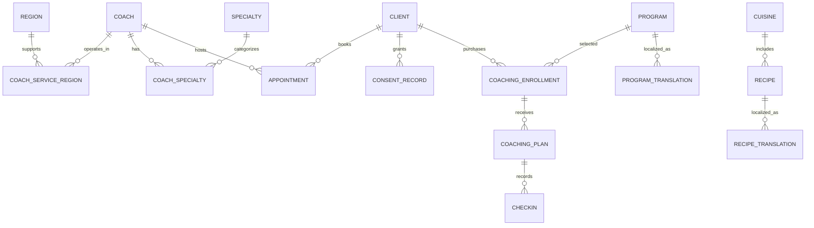

# Conceptual data model & taxonomy

**Planning only.** Phase 1 should use a managed scheduler + CRM; no custom production database.

## Key entities / proposed fields
| Entity | Core fields | Notes |
|---|---|---|
| Region | id, country_code, service_status, currency, regulatory_flags | States/provinces optional, not encoded into brand |
| Locale | code, language, region | BCP 47 identifiers e.g. te-IN/en-US |
| Coach | id, display_name, timezone, status, qualifications_verified_at | Credentials stored privately with approval |
| CoachServiceRegion | coach_id, region_id, language, approved_scope | Limits geography, scope, availability |
| Client | id, contact channels, country, language, timezone | PII; restricted access |
| Lead | id, source, consent, goal_summary, status, created_at | Avoid health histories in marketing lead form |
| Appointment | id, client_id, coach_id, start_utc, end_utc, provider_ref, status | 30-min template at launch |
| Program | id, track, audience, deliverables, active | Region/localized prices separate |
| Offer | id, program_id, currency, amount_minor, country, tax_code | No arbitrary FX conversion |
| Enrollment | id, client_id, program_id, start/end, status | Linked order and invoice metadata |
| CoachingPlan | id, client_id, coach_id, version, state | Private, future portal |
| Recipe | id, cuisine, dietary_tags, ingredients, portions, review_status | Nutrition estimates, allergens, reviewer |
| ProgressCheckin | id, enrollment_id, date, metrics, notes | Sensitive; retention and access control |
| ConsentRecord | client_id, purpose, version, timestamp, source | Separate marketing vs service consent |
| AuditEvent | actor, action, entity_ref, timestamp | Do not log sensitive contents |

## Multi-market design rules
- Country, language, cuisine and timezone are independent dimensions.
- Coaches can serve multiple regions/languages only when legally and operationally supported.
- Recipes may be translated independently; ingredients and portion systems localized.
- Service pricing is explicit per offer/market/currency.
- Roles: public visitor, client, coach, content editor, operations, admin.
- Keep health-related information isolated from public marketing and analytics datasets.

## Data minimization
Public quiz: goal, training location, time window, food preference, language; ephemeral by default. Initial booking: name, email, optionally WhatsApp, locale/timezone, consent. Private clinical/medical screening, if appropriate at all, only after secure intake and professional/legal review.

## Governance
Data dictionary and retention schedule required before production portal; document deletion/export requests and user access controls. Do not reuse client results or photos without separate explicit permission.